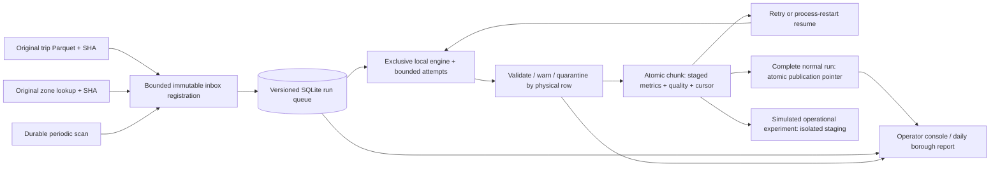

# Architecture

Python/FastAPI exposes local operations; PyArrow reads the small original Parquet in batches. SQLite keeps independent short connections and WAL transactions. Job identity includes both input hashes, partition and pipeline/rule versions. Original occurrences are identified by immutable file digest and zero-based physical row index, so repeated values are not silently collapsed.

The worker owns a process file lock and an in-process processing mutex. An attempt claims a due job transactionally. Each chunk commits output increments, quality counts, quarantine and cursor together; a failed or interrupted chunk cannot expose partial publication. Recovery retains checkpoints and prior attempts, observes the automatic-attempt cap and exposes manual retry cycles. A completed experiment has distinct lineage and does not replace a normal report.

Source bytes/schema and joins are validated before processing; fixed source paths, regular-file checks, size/row caps and checksum verification bound trust. Raw sources are read-only in Docker. Original source text is never instructions or executable code. Numeric rejection evidence is JSON-safe even for malformed/nonfinite values. Source versions/rule decisions remain in run lineage; provenance is rechecked before publication.

The background lifecycle starts/stops the actual engine, coordinates scheduling and reports configured-worker liveness. Stored scheduling survives restart; missed scans coalesce and unchanged input is a visible no-op. Only this known historical source is configured. There is no claim of an enterprise distributed scheduler or a live taxi feed.

All HTTP routes validate loopback Host; browser mutations enforce same-origin and a pre-parser body bound. UI uses textContent, publisher-link allowlists and local-only CSP. It is a single-user localhost app without an authentication system; local processes can access it. Runtime has no credentials or network data acquisition. No other project's database, mutable storage or source dependencies are imported.
