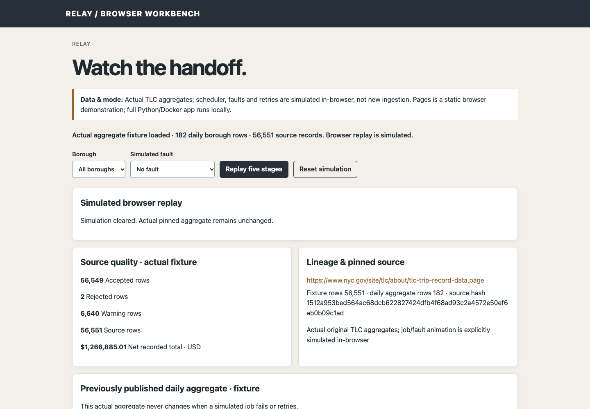

# Relay — data pipeline monitor

**[Open the GitHub Pages browser demo](https://skuraganti.github.io/data-pipeline-monitor/)** · [Architecture](ARCHITECTURE.md) · [Data sources](DATA_SOURCES.md) · [Verification](VERIFICATION.md) · [Roadmap](https://github.com/users/skuraganti/projects/3)

Relay follows a batch import from source files to a published report. It is a local, single-operator app for data engineers and analysts. Scheduled ingestion reads the original NYC TLC January 2024 green-taxi Parquet file and taxi-zone lookup, checks the schema and domain rules, and holds invalid rows in quarantine. Source checksums and physical row indices let you trace rows back to their inputs. If a run fails, checkpoints preserve its progress and retries have a fixed bound. Only a complete normal run publishes results.



## A data-quality and recovery workflow

1. A scheduled scan registers the source and lookup by SHA-256 and processes every row. Two pickups that fall outside January 2024 are quarantined. Negative total amounts, missing passenger counts, zero or extreme distances, and lookup zones labelled Unknown, N/A or Outside of NYC are kept with versioned warnings. Zone IDs absent from the lookup are rejected.
2. Follow a quarantined physical row back to the rule that rejected it, then to the source and lookup hashes. Check the daily borough metrics produced by accepted rows.
3. Choose a labelled operational fault (**Fail once, then recover** or **Exhaust automatic retries**). The run resumes from its last committed checkpoint, or stops after three automatic attempts and raises a local alert. Acknowledgement records operator review; it does not control retry eligibility. The published report stays the same in either case.

The recorded evidence for the pinned source (not a new benchmark) is **56,551** source rows: **56,549** accepted, **2** quarantined, **6,640** accepted rows with warnings, and **182** daily borough aggregate groups. See [PUBLIC_DEMO_DATA.md](PUBLIC_DEMO_DATA.md) and [VERIFICATION.md](VERIFICATION.md).

## How publication and recovery work

- **Atomic checkpoints and counters.** Each chunk commits its staged aggregate increments, quality counts, quarantine evidence and cursor in a single SQLite transaction. A chunk either commits all of this state or none; the next attempt resumes from the last committed cursor.
- **Publication pointer.** Only a complete *normal* run moves the published-report pointer, and the pointer moves atomically. A partial or failed attempt never replaces the current report.
- **Isolated fault runs.** Fault experiments are explicitly simulated. They have their own lineage and staging, and they cannot publish over a normal report. Manual retry cycles keep the earlier failed attempts.

A job is identified by the trip-file hash, lookup hash, partition, and pipeline/rule version. Rescanning unchanged input visibly does no new work (a no-op). Details are in [ARCHITECTURE.md](ARCHITECTURE.md) and [DECISIONS.md](DECISIONS.md). [docs/RECOVERY.md](docs/RECOVERY.md) compares the restart, injected-fault and controlled-kill checks. [docs/QUALITY.md](docs/QUALITY.md) explains quarantine, warning rows and overlapping flags.

## Captured data vs. simulation

| | Pages demo | Full local app |
|---|---|---|
| Data | 182 daily borough aggregates recomputed from the captured TLC file ([fixture and checksum](PUBLIC_DEMO_DATA.md)) | The original 56,551-row TLC file and the zone lookup, downloaded by bootstrap; processing verifies hashes against the local acquisition manifest |
| Queue, faults, retries | **Simulated in the browser** (a five-stage replay, bounded to three attempts) | The real SQLite queue, background scheduler, worker, checkpoints and retries |
| What to try | Filter by borough, then replay with *No fault*, *Fault once, then recover* or *Fault every attempt*. The loaded aggregate stays unchanged, and *Reset simulation* clears only the replay | Inspect quarantined rows and warnings, rescan for a no-op, inject faults, restart the container and confirm that state persists |

Pages has no backend, credentials or model calls, and it cannot run the scheduler, worker or recovery. The browser walkthrough is in [docs/DEMO.md](docs/DEMO.md) and the local walkthrough is in [DEMO.md](DEMO.md).

## Run the full application locally

Requirements: a POSIX host (macOS or Linux), Python 3.13+, [uv](https://docs.astral.sh/uv/), and Docker with Compose. No GPU is needed. Installing dependencies needs internet access, and bootstrap downloads the two original TLC files (`scripts/acquire.py`: fixed URLs, bounded size, no code execution) into the Git-excluded `data/raw/` directory and records a checksum manifest. Later scans verify files against that manifest; compare it with the published hashes in [SOURCE_MANIFEST.json](SOURCE_MANIFEST.json) to reproduce the recorded source version.

```sh
uv sync --frozen
uv run python scripts/bootstrap.py
sh stack.sh up
```

Check `sh stack.sh status` and wait for the container to become healthy, then open **http://127.0.0.1:8282**. Use `sh stack.sh stop` to stop the stack (the named volume is kept), and `sh stack.sh logs` or `sh stack.sh status` to inspect it. The defaults work without copying `.env.example`; that file lists `RELAY_PORT`, `RELAY_DB`, `RELAY_SOURCE_DIR`, `RELAY_AUTO_START`, `RELAY_SCAN_SECONDS` (default 300) and `RELAY_RETRY_SECONDS` (default 5). The helpers use your current Docker context or a supplied `DOCKER_HOST`. Images, networks and volumes are uniquely named `portfolio-release-*`, and the host port binds to 127.0.0.1. Run one portfolio stack at a time on a small machine.

## Verify

```sh
uv run pytest
uv run ruff check .
python3 -m http.server 8008 --bind 127.0.0.1 --directory docs
```

The last command previews Pages at http://127.0.0.1:8008; leave it running. In a second terminal, with agent-browser 0.38.1 installed, `sh scripts/check-pages.sh http://127.0.0.1:8008` runs the browser smoke assertions in `tests/pages-smoke.js`. Run bootstrap first, because the data-boundary integration tests use this checkout's downloaded data. The native suite makes no model calls. Its recorded release result was 22 passing tests; that is a prior check, not a rerun for this documentation edit. [VERIFICATION.md](VERIFICATION.md) separates unit fixtures, actual-source checks, captured evaluations and browser simulations, and records the release check results.

## Scope and limitations

This is scheduled **historical** processing of one known monthly file, not a live taxi stream or a distributed scheduler. It is a single-user localhost app with no authentication. TLC disclaims accuracy, and the quality signals are measured observations, not causal explanations or fraud labels. Two invalid rows and 6,640 warning rows are kept, not hidden. The Pages fixture publishes only derived daily borough aggregates, never trip-level rows. Rights, caveats and source versions are in [DATA_SOURCES.md](DATA_SOURCES.md) and [SOURCE_MANIFEST.json](SOURCE_MANIFEST.json); engineering choices are in [DECISIONS.md](DECISIONS.md) and [PLAN.md](PLAN.md).

## Attribution and license

Upstream components and the original data publishers are credited in [UPSTREAM.md](UPSTREAM.md), and third-party licenses remain in force. Original application code and authored documentation have no open-source license grant; see [LICENSING.md](LICENSING.md).

## Explore projects

[Ledger](https://skuraganti.github.io/personal-spending-tracker/) · [Fieldglass](https://skuraganti.github.io/live-earth-dashboard/) · [Relay](https://skuraganti.github.io/data-pipeline-monitor/) · [Folio](https://skuraganti.github.io/private-ai-knowledge-engine/) · [Contour](https://skuraganti.github.io/ai-codebase-explorer/) · [TraceLab](https://skuraganti.github.io/ai-agent-evaluation-lab/) · [Faultline](https://skuraganti.github.io/ai-incident-investigator/)
